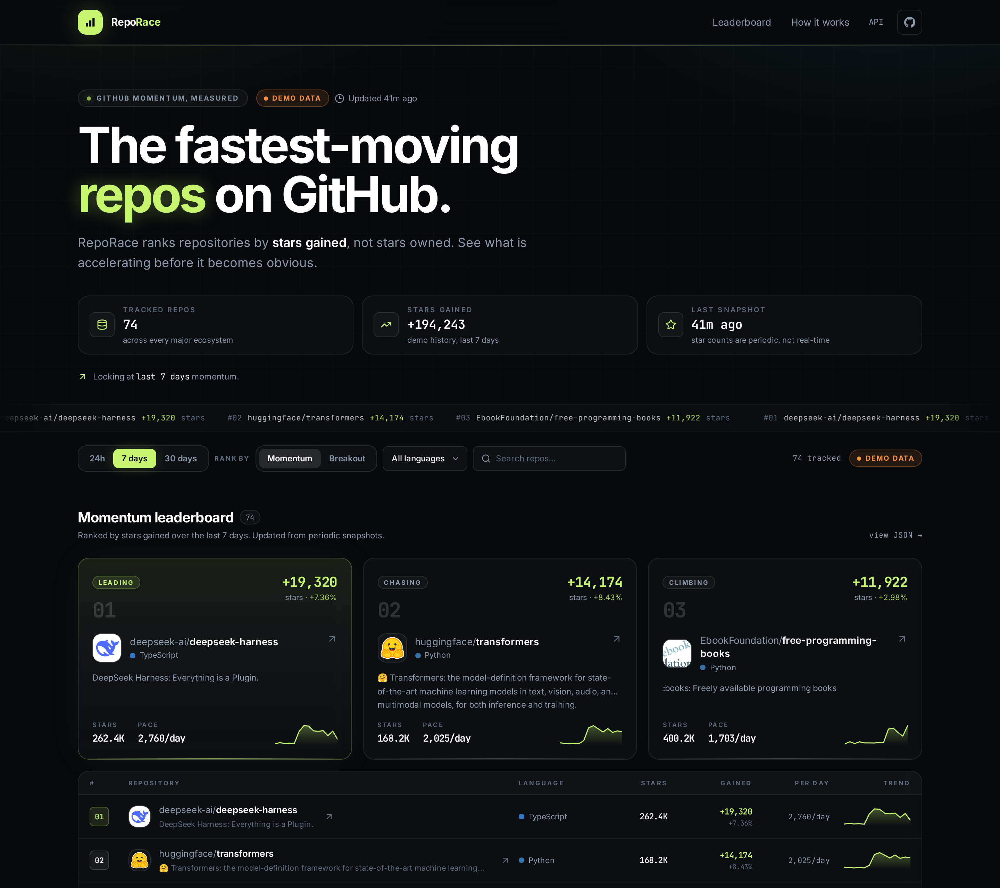
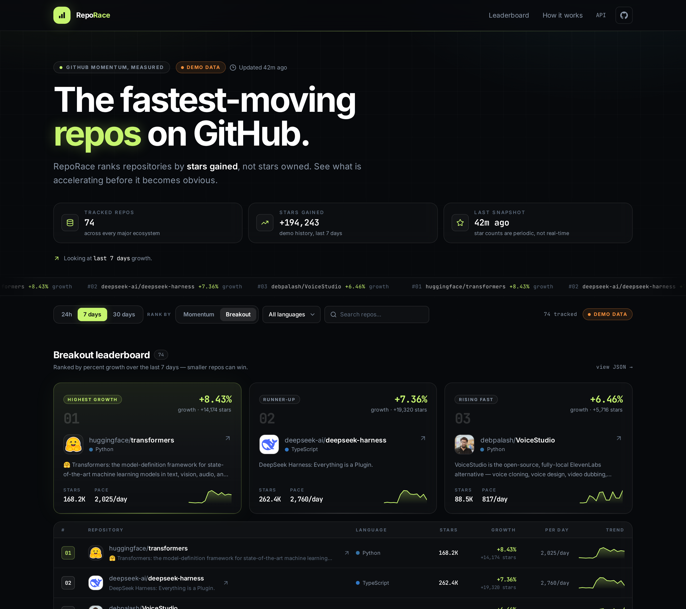
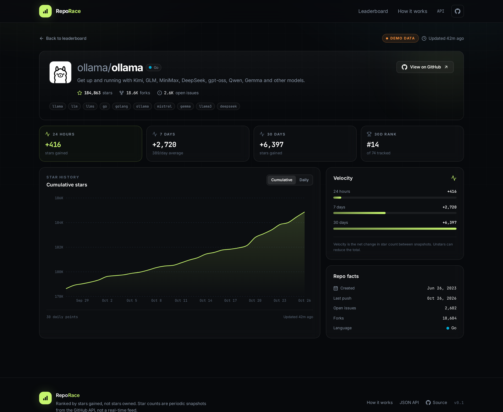

# RepoRace

**See which GitHub repositories are accelerating — not just which ones are already big.**

RepoRace ranks repositories by **star velocity**: stars gained in the last 24 hours, 7 days, or 30 days. A new project gaining 800 stars a day can outrank a famous project that added 600, even if the famous one has 100× more stars.

[](https://github.com/hix-pro/reporace/actions/workflows/ci.yml)
[](LICENSE)
[](https://nodejs.org)



The screenshot above is running with **labeled demo history** (orange `DEMO DATA` badge). Live data starts empty and fills in as snapshots are collected.

---

## Why

GitHub's trending page is a black box, and a raw star total mostly measures age. Star *velocity* is a better signal for what developers are discovering right now. RepoRace makes that signal explicit:

- **Momentum** — rank by total stars gained. The headline number.
- **Breakout** — rank by percent growth relative to repo size. Smaller repos can win.
- **24h / 7d / 30d ranges** — see what is spiking today versus what has been climbing all month.
- **Repo detail pages** — cumulative star chart, daily gains, pace, rank, topics, and facts.

### Breakout ranking

Smaller repositories can outrank giants when ranked by relative growth.



### Repo detail



## Quick start

Requirements: **Node.js 24+** (RepoRace uses the built-in `node:sqlite` module) and a GitHub token.

```bash
npm install

# 1. Fetch real metadata + star totals for the 74 tracked repos
npm run seed

# 2. Optional: generate 30 days of clearly labeled demo history
npm run demo

# 3. Start the API and the dashboard
npm run dev
```

Open **http://localhost:5173**.

The API runs on **http://localhost:8787** and Vite proxies `/api` to it.

### GitHub authentication

`npm run seed` and `npm run collect` call the GitHub GraphQL API. They use, in order:

1. `GITHUB_TOKEN` from `.env`
2. `gh auth token` from the GitHub CLI
3. an error explaining how to authenticate

The easiest setup:

```bash
gh auth login
```

The token only needs public repository read access. Copy `.env.example` to `.env` if you prefer an explicit token.

## Demo data vs. live data

RepoRace never silently presents generated numbers as real.

| Mode | Badge | Meaning |
| --- | --- | --- |
| `demo` | orange `DEMO DATA` | 30 days of generated history for development and screenshots. Star totals in the seed are real; the daily history is not. |
| `live` | green `LIVE` | Daily deltas came from actual snapshots collected by RepoRace. |

`npm run demo` sets `data_mode=demo`. `npm run collect` **deletes the demo history**, switches to live mode, and records a real snapshot. There is no path that quietly upgrades demo rows into live rows.

## How it works

1. **Snapshot** — the collector fetches exact star and fork counts from the GitHub GraphQL API for every tracked repo.
2. **Diff** — each run compares the new total with the previous snapshot and adds the difference to `star_daily`.
3. **Rank** — the API sums daily deltas for the selected range and sorts by momentum or relative growth.

Data lives in a single SQLite file (`data/reporace.db`) with four tables: `repos`, `snapshots`, `star_daily`, and `meta`. Snapshots are timestamped, daily rows are keyed by repo + UTC day, and one collection run is wrapped in a transaction.

### A note on history

GitHub does not expose historical star counts through its public REST or GraphQL APIs. The old stargazer-timestamp endpoint returns `404` for the tokens available to this project, and GraphQL's `stargazers` connection does not provide timestamps.

So RepoRace **collects its own history**. The first collection gives you a baseline; velocity appears after the second. Demo history exists so the UI is usable before that, and it is always labeled.

## Scripts

| Command | What it does |
| --- | --- |
| `npm run dev` | API + Vite dev server together |
| `npm run dev:server` | API only (`tsx watch`) |
| `npm run dev:web` | Vite only |
| `npm run seed` | Fetch real metadata for `data/seed-repos.json` |
| `npm run demo` | Replace daily history with 30 days of demo data |
| `npm run collect` | Clear demo history and capture a live snapshot |
| `npm run build` | Type-check and build the dashboard |
| `npm test` | Run the velocity and data-mode regression tests |
| `npm start` | Serve the built dashboard + API on port 8787 |
| `npm run typecheck` | TypeScript only |
| `npm run db:reset` | Delete the local database |

### Collecting on a schedule

A snapshot every 6 hours is plenty for daily charts. The bundled
`scripts/collect-scheduled.sh` wrapper sets a cron-friendly `PATH`, changes to
the repository root, and timestamps each run:

```cron
0 */6 * * * cd /path/to/reporace && ./scripts/collect-scheduled.sh >> data/collect.log 2>&1
```

Cron does not read your shell profile. The wrapper adds `~/.local/bin` and
`~/.npm-global/bin`, so `gh auth token` works when the GitHub CLI is installed
there. If `gh` is unavailable under cron, put `GITHUB_TOKEN` in `.env`; the
collector loads it automatically. `data/collect.log` is git-ignored.

## API

All endpoints return JSON and are safe to read without auth.

```http
GET /api/health
GET /api/stats
GET /api/repos?range=7d&sort=momentum&language=TypeScript&q=ollama
GET /api/repos/:owner/:name?range=30d
```

`range` is `24h`, `7d`, or `30d`. `sort` is `momentum` or `breakout`. `language` and `q` are optional filters.

Example:

```bash
curl 'http://localhost:8787/api/repos?range=7d&sort=breakout' | jq '.repos[0:3] | map({fullName, gained, growth, rank})'
```

The leaderboard response includes `dataMode`, `updatedAt`, `totalTracked`, and a sparkline for each repo.

## Production

```bash
npm run build
npm start
```

The Express server serves `dist/` when it exists, so one process serves both the dashboard and the API. Set `PORT` to change the API port.

## Limitations

- **History starts when you do.** No backfill from GitHub means the first days are thin. Demo mode exists for this reason.
- **Snapshots, not a firehose.** Velocity is calculated between collection runs. A repo that spikes and fades between runs can be missed.
- **Tracked set.** RepoRace ranks the repos in `data/seed-repos.json`; it is not a complete GitHub index.
- **Net stars.** Unstars reduce the delta. This is intentional, but it is not the same as "gross stars received."
- **No private repos or traffic analytics.**

## Roadmap

- Auto-discover rising repos from GH Archive / ClickHouse instead of a fixed seed list
- Historical backfill from archived event data
- Per-language leaderboards and shareable filter URLs
- Star alerts and weekly digest
- Embeddable SVG badges
- Public hosted instance with scheduled collection

## Project structure

```text
reporace/
├── server/          Express API, SQLite schema, GitHub client, velocity math
├── scripts/         seed, demo-data, collect
├── src/             React dashboard
│   ├── components/  leaderboard, podium, charts, filters, states
│   ├── pages/       HomePage, RepoPage
│   └── lib/         API client and formatting helpers
├── data/            seed list + local SQLite database (ignored by git)
└── docs/            screenshots
```

## Related tools

| Tool | What it does |
| --- | --- |
| [EnvAudit](https://github.com/hix-pro/env-audit) | find missing, undocumented, and unused environment variables |
| [Migration Guard](https://github.com/hix-pro/migration-guard) | statically catch dangerous SQL migrations before they run |
| [API Watch](https://github.com/hix-pro/api-watch) | catch breaking changes in your OpenAPI and JSON contracts |
| [TypeShift](https://github.com/hix-pro/typeshift) | decide the semver bump from a TypeScript declaration diff |
| [ActionLens](https://github.com/hix-pro/action-lens) | see what a GitHub Actions workflow really does, before it hits main |
| [ComposeMap](https://github.com/hix-pro/compose-map) | understand your Docker Compose stack and its production risks at a glance |
| [OpenCode Telegram](https://github.com/hix-pro/opencode-telegram) | control a local OpenCode server from Telegram |
---

_Part of the **[hix tools](https://github.com/hix-pro#readme)** suite — local-first, no backend, CI-ready._

## License

MIT. See [LICENSE](LICENSE).
